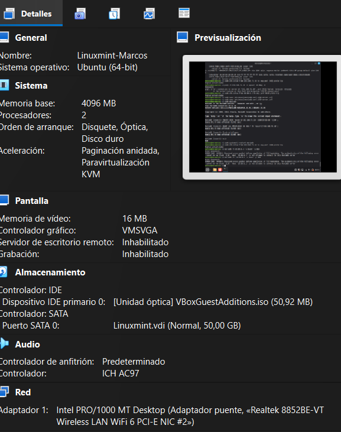
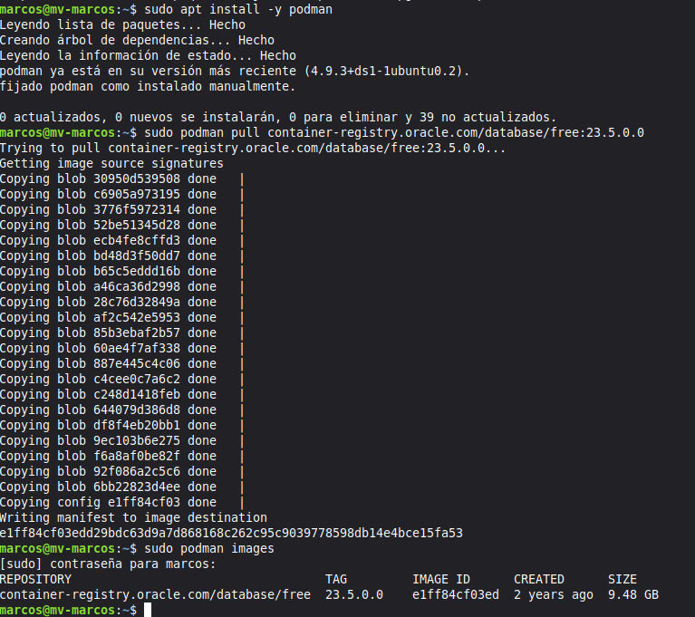
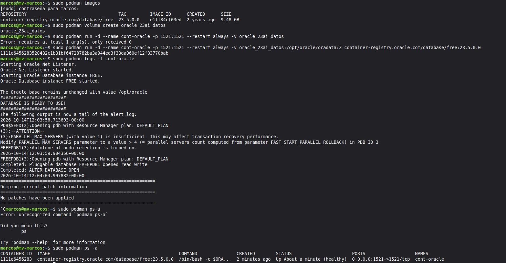
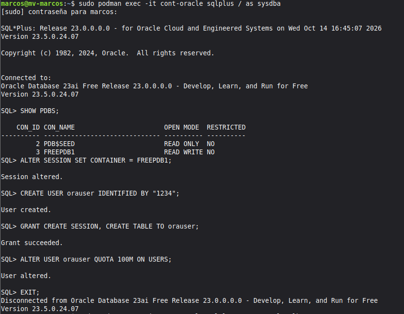
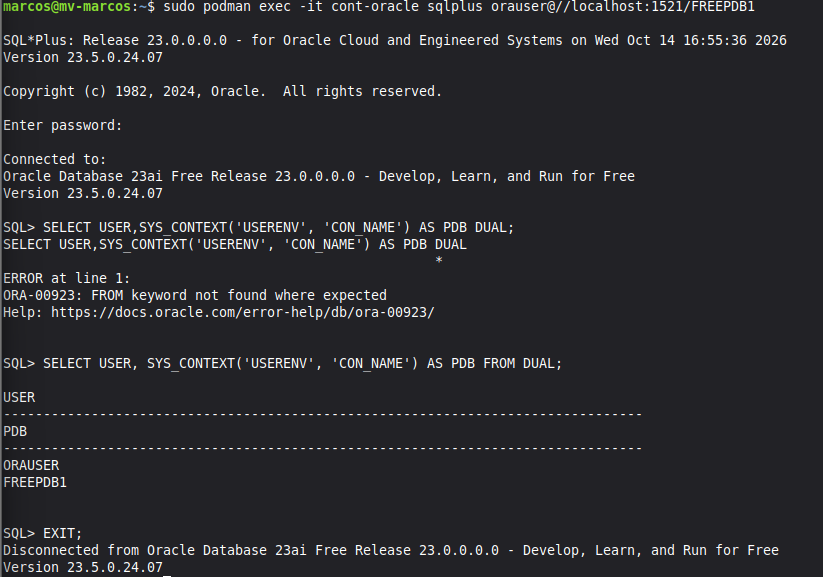
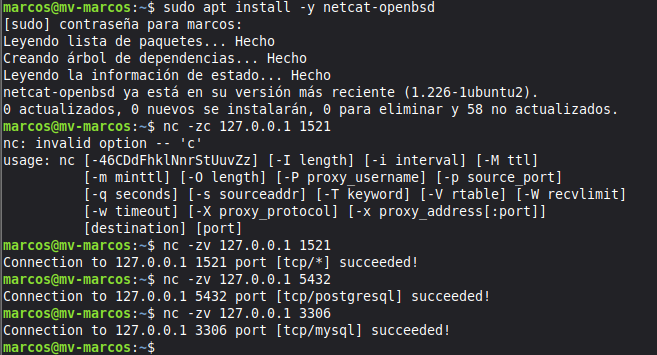
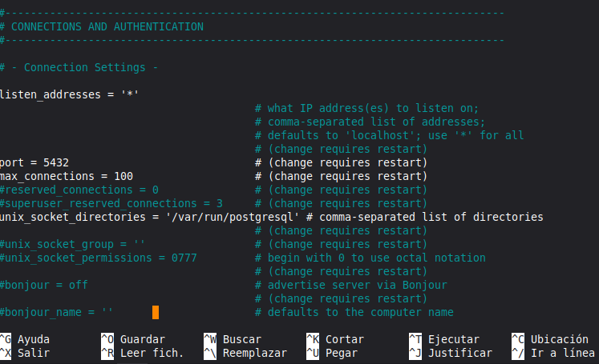
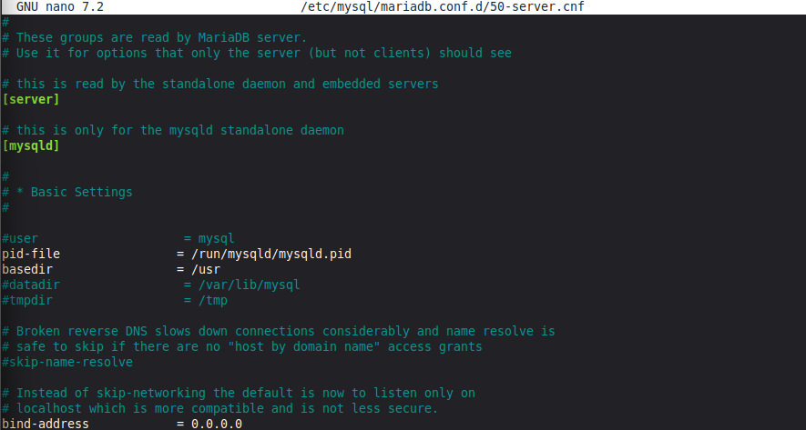

# Práctica: Despliegue de Tres SGBD (Oracle 23ai, PostgreSQL y MariaDB)

## 1. Características del Entorno y Versiones
- **Sistema Operativo:** Linux Mint (Base Ubuntu 24.04 LTS "Noble")
- **Recursos de la Máquina Virtual (VirtualBox):**
  - Memoria RAM: 4096 MB (4 GB)[cite: 8]
  - Procesadores: 2 vCPU[cite: 8]
  - Almacenamiento: 50,00 GB (Disco virtual `Linuxmint.vdi`)[cite: 8]
  - Red: Adaptador 1 en NAT (Intel PRO/1000 MT Desktop)[cite: 8]
- **Versiones de los SGBD instalados:**
  - Oracle Database Free: 23ai Release 23.0.0.0.0 (Versión 23.5.0.24.07 desplegada sobre Podman 4.9.3)[cite: 18, 20]
  - PostgreSQL: 16.15 (Ubuntu 16.15-0ubuntu0.24.04.1)[cite: 24]
  - MariaDB: 10.11.14 (10.11.14-MariaDB-0ubuntu0.24.04.1)[cite: 14]

### Verificación de recursos:

---

## 2. Pasos de Instalación y Despliegue

### 2.1 Oracle Database 23ai Free (con Podman)
1. Se instaló Podman en el sistema mediante `sudo apt install -y podman`[cite: 20].
2. Se descargó la imagen oficial de Oracle Database Free: `container-registry.oracle.com/database/free:23.5.0.0`[cite: 1, 20].
3. Se creó el volumen persistente `oracle_23ai_datos` para salvaguardar los datos de `/opt/oracle/oradata`[cite: 1, 19].
4. Se desplegó el contenedor `cont-oracle` publicando el puerto `1521:1521` con política `--restart always` y la opción `:Z` para los permisos de volumen en SELinux/contenedor[cite: 1, 19].
5. Se monitorizó el arranque con `sudo podman logs -f cont-oracle` hasta confirmar el mensaje `DATABASE IS READY TO USE!`[cite: 19].
6. Se accedió vía SQL*Plus como `sysdba`, se cambió a la PDB `FREEPDB1` y se creó el usuario `orauser` con privilegios de sesión, creación de tablas y cuota de 100M en el tablespace `USERS`[cite: 1, 18].

### 2.2 PostgreSQL
1. Se instalaron los paquetes `postgresql`, `postgresql-contrib` y `php-pgsql` mediante `apt`[cite: 2, 25].
2. Se habilitó e inició el servicio `postgresql` comprobando su estado activo con `systemctl`[cite: 2, 24].
3. Desde la sesión del usuario del sistema `postgres`, se ejecutó `psql` para crear la base de datos `dbpg`[cite: 2, 24].
4. Se creó el usuario `pguser` con su contraseña y se le concedieron todos los privilegios sobre la base de datos `dbpg`[cite: 2, 24].

### 2.3 MariaDB
1. Se instaló el servidor y el cliente mediante `sudo apt install -y mariadb-server mariadb-client`[cite: 2, 17].
2. Se habilitó y arrancó el servicio `mariadb` mediante `sudo systemctl enable --now mariadb`[cite: 2, 16].
3. Desde la consola `sudo mariadb`, se creó la base de datos `dbm` con codificación `utf8mb4` y cotejamiento `utf8mb4_unicode_ci`[cite: 2, 14].
4. Se dio de alta al usuario `'muser'@'localhost'` con contraseña y se le otorgaron privilegios completos sobre `dbm.*`[cite: 2, 14].

---

## 3. Comprobación del Estado y Conexiones Locales

### Descarga de la imagen de Oracle:
Comprobación de la imagen descargada en el registro local con `podman images`[cite: 1, 20]:

### Estado del contenedor de Oracle:
Contenedor en ejecución y estado saludable (`Up About a minute (healthy)`) mapeando el puerto `1521`[cite: 1, 19]:

### Creación del usuario y cuota en Oracle:
Configuración en la PDB `FREEPDB1` como `sysdba`[cite: 1, 18]:

### Conexión local a Oracle (orauser @ FREEPDB1):
Conexión interactiva a SQL*Plus autenticándose como `orauser` y verificando la sesión activa con `SELECT USER, SYS_CONTEXT('USERENV', 'CON_NAME') AS PDB FROM DUAL;`[cite: 1, 2, 26]:

### Conexión local a PostgreSQL (pguser @ dbpg):
Verificación del servicio activo, creación de base de datos/usuario y conexión interactiva con `psql` comprobada con `SELECT current_user, current_database();`[cite: 2, 24]:
.png)

### Conexión local a MariaDB (muser @ dbm):
Creación de la base de datos, asignación de privilegios y conexión local interactiva verificada con `SELECT user(), current_user(), database();`[cite: 2, 14]:
.png)

### Comprobación de puertos locales con Netcat:
Disponibilidad local comprobada de los puertos 1521 (Oracle), 5432 (PostgreSQL) y 3306 (MariaDB) con `nc -zv 127.0.0.1 <puerto>`[cite: 2, 13]:

---

## 4. Configuración de Conexiones Remotas

### 4.1 PostgreSQL
- Se editó el archivo `postgresql.conf` habilitando la directiva `listen_addresses = '*'`[cite: 3, 12]:

- En `pg_hba.conf` se añadió la directiva de autenticación remota `scram-sha-256` para la IP/subred cliente autorizada[cite: 3].
- Se habilitó la regla en el cortafuegos mediante `sudo ufw allow ...` en el puerto 5432 TCP[cite: 3, 10].

### 4.2 MariaDB
- En `50-server.cnf` se modificó el parámetro de enlace a `bind-address = 0.0.0.0` para admitir peticiones externas[cite: 3, 9]:

- Desde la consola de MariaDB se autorizó el usuario remoto mediante `CREATE USER 'muser'@'IP_CLIENTE'` y su respectivo `GRANT` sobre `dbm.*`[cite: 3].
- Se habilitó el puerto 3306 TCP en el cortafuegos `ufw` y se reinició el servicio[cite: 3].

---

## 5. Problemas Encontrados y Soluciones
- **Argumentos incompletos en Podman:** Al invocar `podman run` faltaron la ruta de destino del volumen y la imagen de Oracle, devolviendo `Error: requires at least 1 arg(s), only received 0`[cite: 5, 19]. Se solucionó ejecutando la orden completa en una línea con la sintaxis de persistencia `:Z`[cite: 19].
- **Error de sintaxis en PostgreSQL:** Al intentar encadenar la creación de la base de datos y el usuario sin delimitador `;` se generó `ERROR: syntax error at or near "CREATE"`[cite: 24]. Se solucionó ejecutando cada sentencia SQL de manera independiente[cite: 24].
- **Omisión de cláusula FROM en Oracle:** Se produjo el error `ORA-00923: FROM keyword not found where expected` al omitir `FROM DUAL` al consultar variables de sesión en SQL*Plus[cite: 26]. Se corrigió ejecutando la consulta válida de Oracle `SELECT USER, SYS_CONTEXT('USERENV', 'CON_NAME') AS PDB FROM DUAL;`[cite: 26].
- **Parámetro no reconocido en Netcat:** Se introdujo la opción no válida `-zc` obteniendo `nc: invalid option -- 'c'`[cite: 13]. Se solventó usando la opción estándar `-zv` para comprobar la apertura del socket TCP sin envío de datos[cite: 13].
- **Dirección de origen en UFW:** Al escribir el texto literal de la plantilla se devolvió `ERROR: Dirección de orígen errónea`[cite: 7]. Se corrigió identificando la IP real del segmento de trabajo con `ip a`[cite: 10].
- **Conexión remota rehusada por aislamiento NAT:** Al probar la conexión hacia una IP externa se obtuvo `connection to server at "192.168.71.10", port 5432 failed: Conexión rehusada`[cite: 10]. El adaptador de VirtualBox se encontraba en modo NAT (`10.0.2.15/24`)[cite: 8, 10], impidiendo que la máquina cliente acceda a la máquina virtual sin reenvío de puertos o sin configurar el adaptador en modo puente (Bridged).

---

## 6. Fuentes Consultadas
- [Oracle Database Free Get Started](https://www.oracle.com/es/database/free/get-started/)[cite: 1, 4]
- [PostgreSQL Documentation: Client Authentication (pg_hba.conf)](https://www.postgresql.org/docs/)[cite: 3, 4]
- [MariaDB Knowledge Base: Configuring MariaDB for Remote Client Access](https://mariadb.com/kb/en/)[cite: 3, 4]
